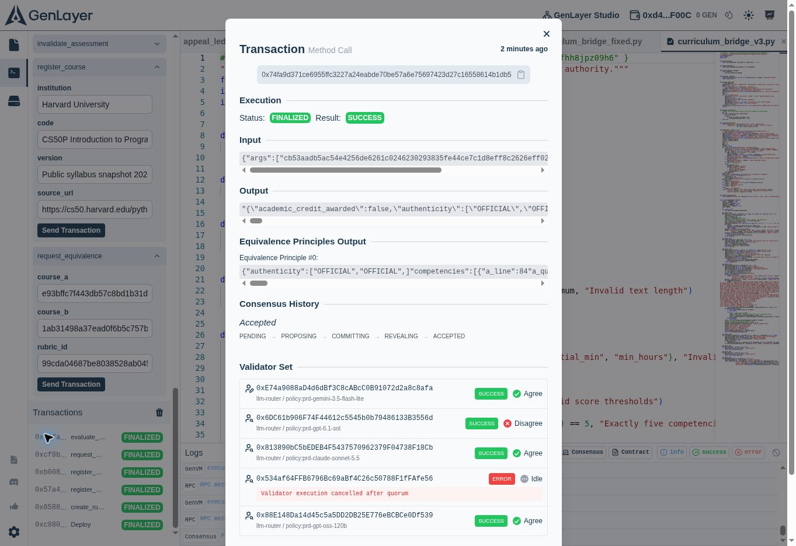

# Studio deployment record

Date: 19 November 2026 (Asia/Colombo).

## Canonical MVP instance

- Environment: hosted GenLayer Studio (`https://studio.genlayer.com`). Development deployment, not a Bradbury/mainnet deployment.
- Contract: `0x8d71589e91cc5C1Ea81398a956D93E195E24A29F`
- Deployment transaction: `0xc0807d288e7b049dd3cd739bbcc051dfe1fee08cdee76bee94c4c29eeb058aca`
- Deployment finalized successfully, using the existing Studio inbuilt account, with Normal (Full Consensus) selected and Simulation Mode off.
- Studio editor filename: `curriculum_bridge_v3.py`; source matches the canonical repository file `contracts/curriculum_bridge.py`.
- No browser wallet connection, private-key export or external wallet setup was used.

## Registered evidence and rubric

| Record | ID |
| --- | --- |
| MIT 6.0001 Fall 2016 (source A) | `e93bffc7f443db57c8bd1b31d0fd849b08068bf3261c0ea9ef1ae62778251bb8` |
| Harvard CS50P public syllabus snapshot (target B) | `1ab31498a37ead0f6b5c757b7280468a9e9cc89f234026497cd694182f516e6c` |
| Introductory Python topic coverage v2 rubric | `99cda04687be8038528ab04507aabb188f4524cc533ecdb42aff1aafbb9614c1` |
| MIT → Harvard assessment | `cb53aadb5ac54e4256de6261c0246230293835fe44ce7c1d8eff8c2626eff02a` |

## Verification scope

22 behavioral tests pass locally. The repository also has GitHub Actions for behavioral tests and Python syntax checking. These tests use a boundary double; hosted deployment and real-provider evaluation are separate checks.

The initial development instance (`0x40235183Cb4A127Bd4622c802236178f845a9aE3`) exposed non-JSON model output and disagreement during evaluation transaction `0xb40cc9130748a2dc7c3e785245e810eb41d24db09a9fcffaf3e9aba53eb62958`. It is not the canonical deployment. The final source requests structured JSON and clarifies that suggested exercises alone do not establish assessed practical work. The corrected source was deployed as a fresh instance, preserving the initial instance's history.

Studio is a development environment. Records can disappear if the hosted environment resets; use the source and demo guide to reproduce them.

The second development instance (`0x9dDC26208Ee45F6CAD8A2EB6b29727f7Ec5Ef148`) exposed exact-quotation failures and semantic disagreement. The canonical v3 instance resolves numbered evidence anchors directly into locked text, avoiding model-generated quote transcription. Both earlier instances remain development history and should not be used as the canonical deployment.

## Final-instance initialization transactions

| Action | Transaction | Verified execution |
| --- | --- | --- |
| Create topic rubric | `0x658880e395286c64b989d0d0e693ec56ca2775e64c952372309f7f6b63c4f3db` | Finalized |
| Register MIT syllabus | `0x57a420a2f3dfcbf10091f9516d28d9291035e38f1867b4fae6f4bf28ec30b341` | Finalized |
| Register Harvard syllabus | `0xb0089c99d24ff75c2f20d7b12e4f418fee7b49ae4bbe93f267eda15fc97cdd48` | Finalized, SUCCESS, correct course ID returned |

## Live consensus result

Final contract assessment ID: `cb53aadb5ac54e4256de6261c0246230293835fe44ce7c1d8eff8c2626eff02a`.
Evaluation transaction: `0x74fa9d371ce6955ffc3227a24eabde70be57a6e75697423d27c16558614b1db5`.
The normal full-consensus round was accepted with three Agree results, one Disagree result and one validator cancelled after quorum. This is protocol agreement, not unanimity. The evaluation transaction finalized with SUCCESS. The result was read back through `get_equivalence` with the Finalized state selected; status is EVALUATED and invalidation is null.

| Field | Recorded value |
| --- | --- |
| Direction | MIT A satisfies Harvard B |
| Verdict | INCONCLUSIVE |
| Weighted coverage | 85 / 100 |
| Fundamentals | MET |
| Functions/decomposition | MET |
| Collections | MET |
| Testing/debugging | MET |
| Required/assessed practical work | UNKNOWN |
| Missing evidence / coverage gap | practice |
| Required-core gap | true |
| Source A fingerprint | `83cacc74409faa8d8f5a7c61b20668cd417f041da3b99210f1785d5c9ff1b9ea` |
| Source B fingerprint | `c11978f75bab1fe9823cd226ab19d7ca4ef0c6c330cdc068448c8731c0ce74de` |
| Credit awarded | false |

The target syllabus contains topic outlines and suggested exercises but does not explicitly document required/assessed programming assignments in this locked snapshot. The contract records that evidence gap instead of treating the high aggregate coverage as equivalence. This does not assert that Harvard's course lacks practical work; it describes the evidence available at this URL and snapshot.

Deployed canonical source SHA-256: `5fc97aae9495b9dcaa99e40bae114c913708080fe3872b47683d542eabc105ee`.

[GitHub Actions: 22 behavioral tests and syntax check passed](https://github.com/amzar1st/CurriculumBridge-Decentralized-Course-Equivalence-Registry/actions/runs/44458055945).
